# gemma-developer-agent
**Can a small local agent redo a cloud agent's work?**

> **Personal learning project.** Built on my own time: not affiliated with or endorsed by any employer, institution or
> vendor, and nothing here is any organization's plan, study or finding. Every patient record in the source repository
> is synthetic.

**Paper Track submission:** [Can a small local agent redo a cloud agent's work?](https://kaggle.com/competitions/gemma-4-developer-agent-paper/writeups/can-a-small-local-agent-redo-a-cloud-agents-work)
· [the paper as a PDF](paper/small-local-agent-redo-cloud-agent-work.pdf)
· [the paper as submitted (release)](https://github.com/healthtransformationlab/gemma-developer-agent/releases/latest)
· [the 93 tasks on Kaggle](https://www.kaggle.com/datasets/jcblearning/health-transformation-lab-coding-agent-tasks)

In fifteen days, one person in the loop with a cloud coding agent took a health-data repository from nothing to 960
commits and 2,269 tests, without typing code. This repository asks how much of that work a small model, one that
runs on a single GPU, can redo by itself. It holds a coding agent for the Gemma 4 Developer Agent Competition, the
paper on what that agent did, and where each number in the paper comes from.

<a href="https://healthtransformationlab.org/gemma-developer-agent/pitch/deck.html">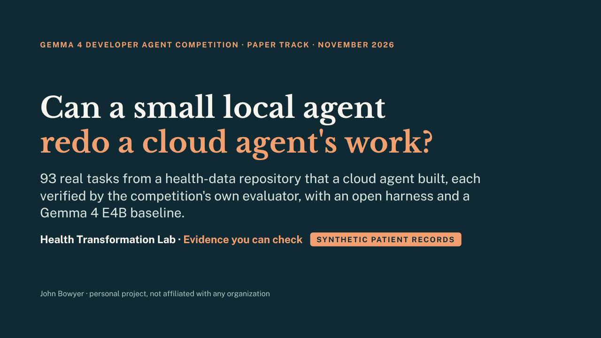</a>

**[Play the slides](https://healthtransformationlab.org/gemma-developer-agent/pitch/deck.html)** · [read them with speaker notes](docs/pitch/full_text_and_notes.md) · [as a PDF](docs/pitch/deck.pdf)

<details>
<summary><b>See the 12 slides here</b> (tap to open)</summary>

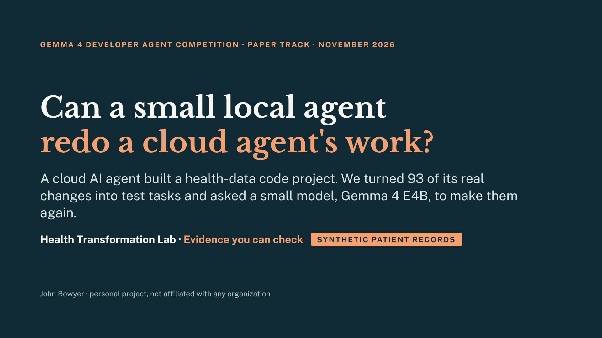

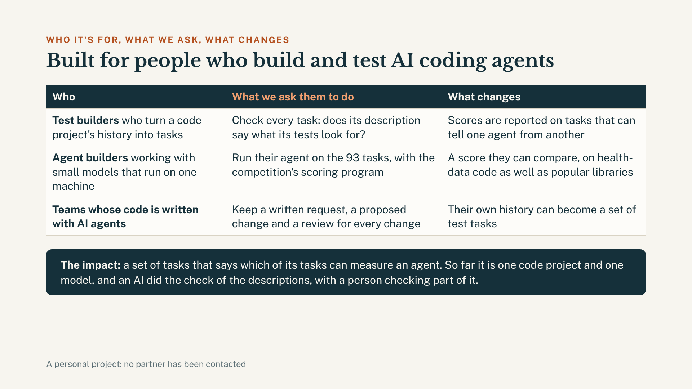

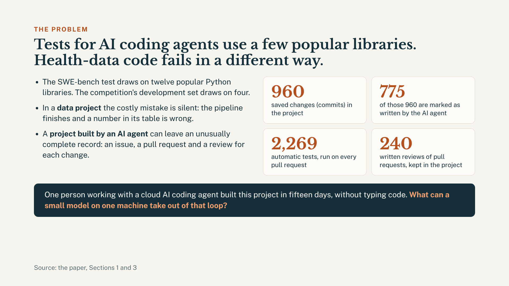

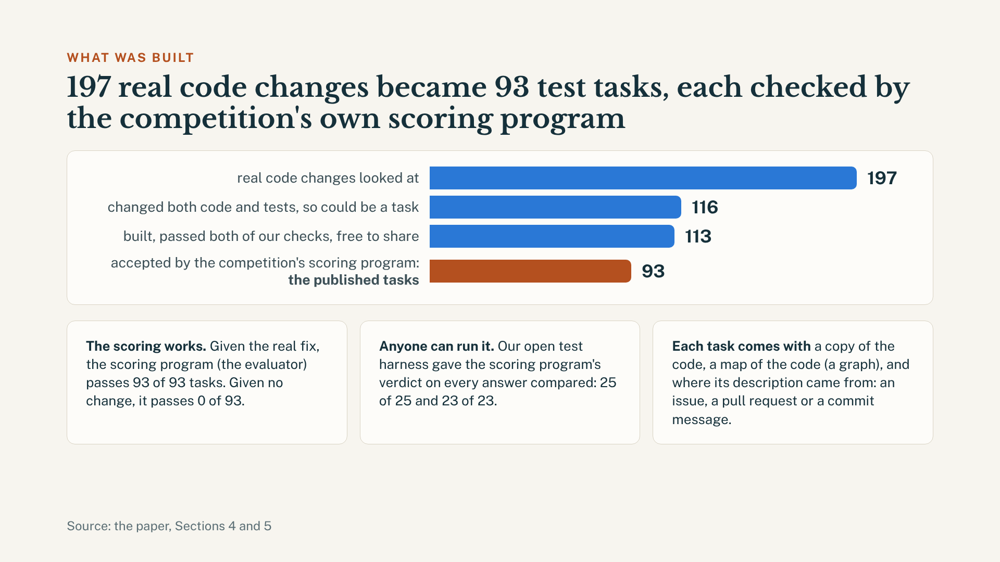

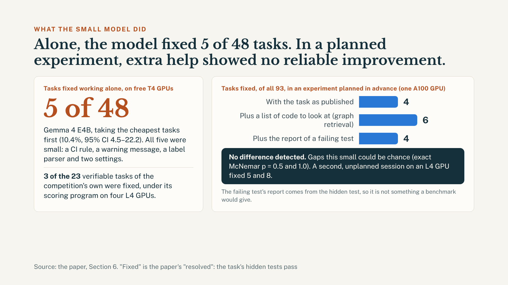

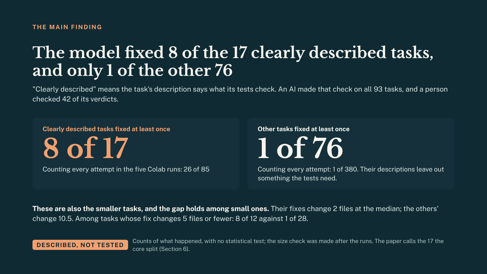

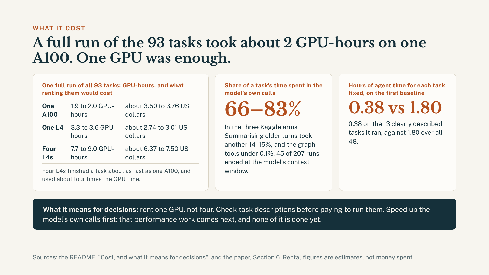

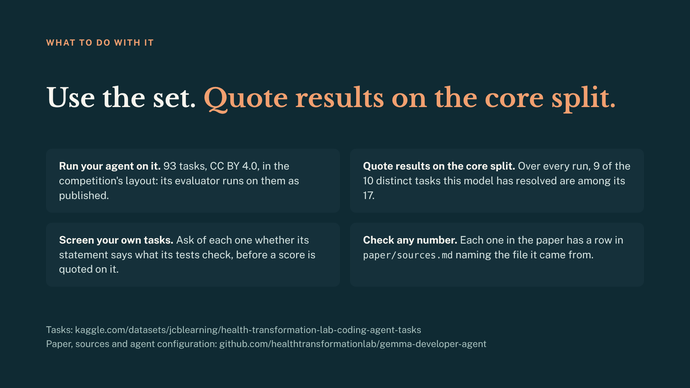

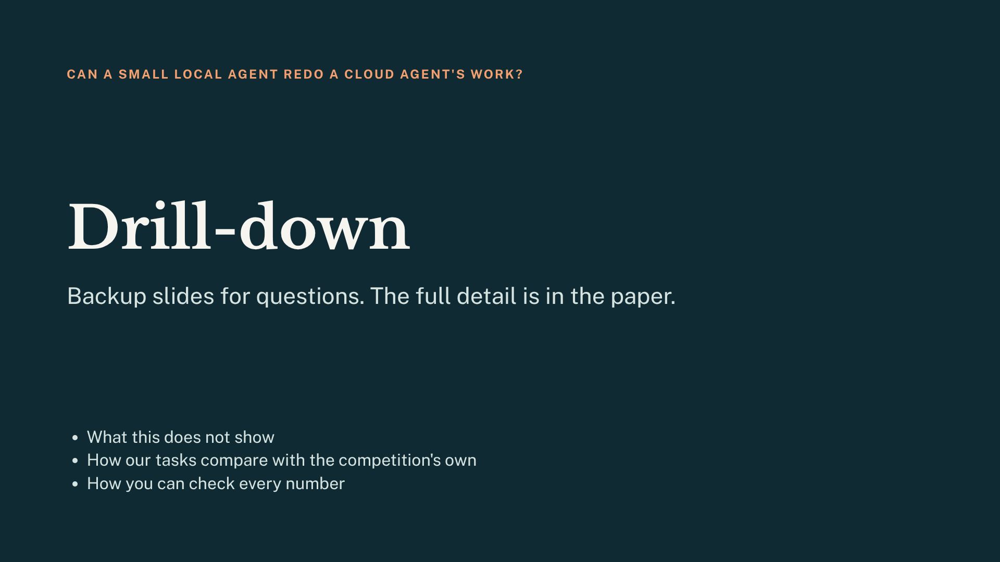

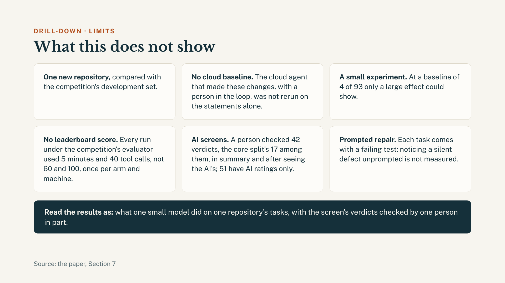

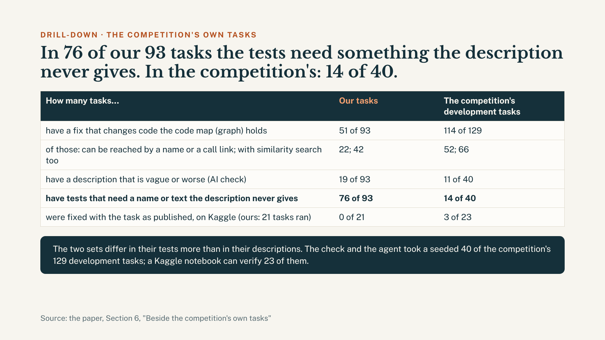

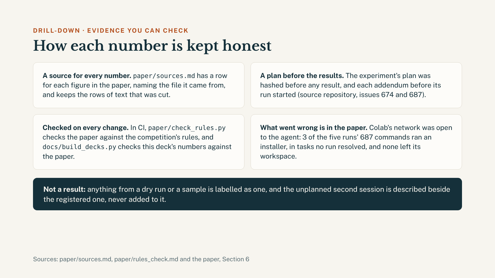

Each slide with its speaker notes: [the pitch, slide by slide](docs/pitch/full_text_and_notes.md).

</details>

## Results at a glance

The model is Gemma 4 E4B, small enough to run on one GPU. The 93 tasks are real changes from that repository, each
checked by the competition's own scoring program (its evaluator). A task counts as **fixed** when its hidden tests
pass with the model's change; the paper says "resolved".

**1. Working alone, the model fixed 5 of 48 tasks.**
That is 10.4% (95% CI 4.5–22.2), on free T4 GPUs, and all five were small fixes. It ran the cheapest tasks first
under a cap on GPU hours, so this is not a rate for all 93.

**2. Extra help showed no reliable improvement.**
In an experiment planned in advance (pre-registered), the model tried all 93 tasks three ways on one A100 GPU:

| What the model was given | Tasks fixed, of 93 |
|---|---|
| Only the task, as published | 4 |
| The task and a list of code to look at (graph retrieval) | 6 |
| The task and the report of a failing test | 4 |

Differences this small could be chance: no difference detected (exact McNemar p = 0.5 and 1.0). The failing test's
report comes from the hidden test, so a benchmark would not give it.

**3. It fixed the clearly described tasks, and almost none of the others.**
A task is "clearly described" when its description says what its tests check. An AI screen of all 93 found 17 of
them (the paper's core split). Tasks fixed at least once, in the three planned runs above and in all five runs (two
more came from an unplanned second session):

| Kind of task | Planned three | All five |
|---|---|---|
| Clearly described | 6 of 17 | 8 of 17 |
| All the others | 0 of 76 | 1 of 76 |

These are counts of what happened, not a planned test.

**The clearly described tasks are also the smaller ones.** Their fixes change 2 files at the median; the others'
change 10.5. So the same count was made for small fixes only: 5 files or fewer, since no task with a larger fix was
fixed in any run.

| Kind of task, small fixes only | Fixed at least once, all five runs |
|---|---|
| Clearly described | 8 of 12 |
| All the others | 1 of 28 |

The gap is still there among small tasks. This check was made after the runs, so it describes them and tests nothing.

**4. One GPU ran all 93 tasks in about 2 GPU-hours.**
That was one A100; rented, an estimated 3.50 to 3.76 US dollars for the run.
[What it cost, and what that means for decisions](#cost-and-what-it-means-for-decisions).

One model, one repository, and an AI screen that a person checked in part:
[what this does not show](paper/small-local-agent-redo-cloud-agent-work.md#7-limitations). Each run, with its
hardware, interval and cost, is in [the table below](#what-has-been-run-and-what-it-cost).

## Where to go next

| For | Go to |
|---|---|
| **Executives** (8 slides, 5 minutes, plus backup) | [play the slides](https://healthtransformationlab.org/gemma-developer-agent/pitch/deck.html) · [read the pitch with speaker notes](docs/pitch/full_text_and_notes.md) · [slides as a PDF](docs/pitch/deck.pdf) |
| **Scientists** | [the paper](paper/small-local-agent-redo-cloud-agent-work.pdf) ([as text](paper/small-local-agent-redo-cloud-agent-work.md)), [where each number comes from](paper/sources.md), [the paper against the competition's rules](paper/rules_check.md), [every run and what it cost](#what-has-been-run-and-what-it-cost), [the experiment's plan, addenda and tables](https://github.com/healthtransformationlab/health-transformation-lab-nlp/blob/526ea08c75e063ba8d288883ccf47144ea367386/data/tasks/official_agent_runs/README.md) |
| **Engineers** | [the agent, file by file](docs/agent_walkthrough.md), [the competition's rules as read here](docs/rulebook-notes.md), [the dataset's format](docs/dataset-format.md), [the starter notebook](docs/starter-notebook-notes.md), [how we work](AGENTS.md) |

## The question behind the agent

**Does a well-run data repo make a small AI coding agent better at fixing bugs?**

The idea is that five things a well-run repo has do part of the agent's thinking for it. What has been measured and
run is a baseline (below); the comparison with and without them has not been run.

| Ingredient | In one line |
|---|---|
| Metadata-driven | The pipelines, runs, lineage and runbook are tables, not logs |
| Conventions | Typed names; every change traced to an issue |
| Configuration management | One place per setting; credentials and dependencies with expiry dates |
| Telemetry | Every call records timing and cost: [what the runs cost](#cost-and-what-it-means-for-decisions) |
| Forecasting | Because of the four above, failures are predicted with a date |

Licence: [Apache 2.0](LICENSE), the licence type the competition names for winning submissions.

## Cost, and what it means for decisions

Every run recorded its own GPU time. This is one full run of all 93 tasks, under the competition's evaluator, on
each machine it ran on. Rental is an estimate, in US dollars.

| Machine | GPU-hours | Rental, whole run | Rental, each task fixed |
|---|---|---|---|
| One A100 | 1.9–2.0 | 3.50–3.76 | 0.58–0.94 |
| One L4 | 3.3–3.6 | 2.74–3.01 | 0.34–0.60 |
| Four L4s | 7.7–9.0 | 6.37–7.50 | 1.50–1.59 |

Four L4s are the competition's own setup, run on Kaggle. The A100 and the single L4 were Colab sessions, and the
single L4 was the unplanned second session.

The rental figures are estimates, not money spent: the GPU time at a median on-demand price (0.83 US dollars an
L4-hour, 1.87 an A100-hour). Kaggle's GPUs were free within a weekly allowance of about 30 hours, and Colab is a
subscription. Each machine ran in its own session, with its own software versions, once for each arm, and a run
fixed between 4 and 8 tasks, so the cost of a fix moves a lot from run to run. Where the figures come from:
[the `_gpu.csv` table beside each run](https://github.com/healthtransformationlab/health-transformation-lab-nlp/tree/526ea08c75e063ba8d288883ccf47144ea367386/data/tasks/official_agent_runs)
and [the prices](https://github.com/healthtransformationlab/health-transformation-lab-nlp/blob/526ea08c75e063ba8d288883ccf47144ea367386/ops/cost_settings.yaml).

**What this means when choosing how to run it**

- **Rent one GPU, not four.** On these runs four L4s finished a task about as fast as one A100 (1.2 to 1.5 minutes
  against 1.2 to 1.3) and used about four times the GPU time. For a run of your own, one L4 was the cheapest here and one A100
  the quickest. The competition scores entries on four L4s; the last row is what that setup cost here.
- **Check the task descriptions before paying to run them.** On the first baseline the 13 clearly described tasks
  took 17% of the agent's time and gave 4 of its 5 fixes: 0.38 hours of agent time a fix, against 1.80 over all 48.
- **Handing the model a list of code to look at cost nothing extra.** Time and tokens for a task were the same or a
  little lower with it (the list is made beforehand). That choice can rest on results alone, and the results showed
  no reliable improvement.
- **Speed up the model's own calls first.** In the three Kaggle arms they took 66–83% of a task's time. Summarising
  older turns took another 14–15%, the graph tools under 0.1%, and 45 of 207 runs ended when the conversation
  outgrew the model's context window. For one task the model reads about 100 to 125 thousand tokens and writes about 5 to 7 thousand.

**Next: performance work.** None of this has been done or measured yet.

- Send the model less to read on each turn (shorter tool output, a tighter history): it reads roughly twenty times
  what it writes.
- Tune or replace the summarising of older turns, which takes 14–15% of a task's time and still leaves runs ending
  at the context window.
- Run the same tasks on one GPU and on four under the same software, to confirm that one is enough.
- Try more than one task at a time on a GPU, where tasks can be kept apart.
- Record tokens a second and how long each model call waits, so that the next change is judged by the same tables.

## What has been run, and what it cost

Gemma 4 E4B on the 93 tasks built from
[`health-transformation-lab-nlp`](https://github.com/healthtransformationlab/health-transformation-lab-nlp)'s history.
One row per run. Time and tokens are averages for one task, from each run's own log.

| Run | Hardware and budget | Resolved | Agent time a task | Tokens a task |
|---|---|---|---|---|
| Local harness, cheapest tasks first | 2 × T4 on Kaggle; 2,048 output tokens a turn | **5 of 48** (10.4%, 95% CI 4.5–22.2) | 11.3 min | 112k in, 4.4k out |
| The same, larger budget | 1 × L4 on Colab; 16,384 output tokens a turn, thinking on | 2 of the 23 cheapest (2 before) | 5.4 min | not logged |
| The competition's own evaluator, end to end | 4 × L4 on Kaggle; the competition's 5-minute budget | 0 of a random 20 (95% CI 0–16.1) | 1.7 min, plus 5.9 min to load the model | 124k in, 6.7k out |
| The competition's development set, same evaluator | 4 × L4 on Kaggle; the same 5-minute budget; a seeded 40 of its 129 tasks | 3 of the 23 a Kaggle notebook can verify (95% CI 4.5–32.1) | 1.8 min | 121k in, 6.9k out |
| Pre-registered experiment: as published (the baseline arm) | 4 × L4 on Kaggle; the same 5-minute budget; all 93 tasks | 0 of the 21 tasks run before its model server failed; 72 not run | 1.7 min | 125k in, 6.2k out |
| The same, with graph retrieval done for the agent | the same | **4 of 93** (95% CI 1.7–10.5) | 1.2 min | 103k in, 4.7k out |
| The same, with the failing test's report (from the hidden test: not a benchmark condition) | the same | **5 of 93** (95% CI 2.3–12) | 1.5 min | 101k in, 4.9k out |
| The experiment again on Colab: as published | 1 × A100 on Colab; the same 5-minute budget; all 93 tasks | **4 of 93** (95% CI 1.7–10.5) | 1.3 min | 108k in, 5.4k out |
| The same, with graph retrieval | the same notebook session | **6 of 93** (95% CI 3–13.4) | 1.2 min | 103k in, 4.9k out |
| The same, with the failing test's report (from the hidden test) | the same notebook session | **4 of 93** (95% CI 1.7–10.5) | 1.3 min | 108k in, 5.2k out |
| As published again, by a second session at the same time (unplanned) | 1 × L4 on Colab; the same budget; all 93 tasks | 5 of 93 (95% CI 2.3–12) | 2.3 min | 110k in, 5.0k out |
| That session's graph-retrieval arm | the same L4 session | 8 of 93 (95% CI 4.4–16.1) | 2.1 min | 103k in, 4.7k out |

- **Controls.** On the published files the competition's evaluator resolves 93 of 93 reference patches and 0 of
  93 empty patches, and gives the same verdict as the local harness on all 48 agent patches compared: 25 saved
  from the baseline run, on the first release, and 23 from a rerun, on the corrected release (the two rows of the
  table in the paper's Section 5).
- **Cost of a fix.** 1.80 hours of agent time a fix across the 48. The 13 attempted tasks whose statements say
  what their tests check (an AI screen of all 93; a person checked 42 of its verdicts in summary, the core split's 17 among them) gave 4 of the 5 fixes for 17% of that
  time: 0.38 hours a fix.
- **With more context.** A pre-registered experiment gave the agent graph retrieval, or a failing test's report,
  on all 93 tasks. On Kaggle its baseline arm lost its model server after 21 tasks, none of which any arm resolved,
  and the weekly GPU allowance ran out before the rerun the plan allows
  ([the rerun](https://github.com/healthtransformationlab/health-transformation-lab-nlp/issues/681) is owed).
  So all three arms ran again on one Colab A100, under addenda hashed before each started
  ([issue 687](https://github.com/healthtransformationlab/health-transformation-lab-nlp/issues/687)).
  There the baseline resolved 4 tasks, graph retrieval those 4 and 2 more (exact McNemar
  p = 0.5), and the report 3 of them and 1 more (p = 1.0): no difference is claimed, and none is ruled out.
  A second, unplanned session ran the first two arms on an L4 at the same time and resolved 5 and 8
  (p = 0.375, described only):
  two runs of the baseline differed on 3 tasks. Of the 17-task core split
  (statements that an AI screen finds say what their tests check), 8 tasks were resolved in at least one of
  the five Colab runs, and 1 of the other 76 tasks; counting each task once in each run (task-runs),
  26 of 85 and 1 of 380. Where the retrieval listed a function the fix edits (41 tasks), 5 of the
  core split's 7 were resolved in some Colab run and none of the other 34 (12 of 35 task-runs and 0 of 170): a comparison
  made after the runs, described and not tested.
  Colab's network was open to the agent's commands, where Kaggle's kernels have none:
  3 of the five runs' 687 commands ran an installer, in tasks no run resolved.
- **Where the time went.** The kernels kept OpenTelemetry spans (names, counts and seconds). In the experiment's
  three Kaggle arms, 66–83% of a task's time was model calls, 14–15% context compaction and under 0.1% the
  graph tools; 45 of 207 runs ended when a prompt passed the model's context window. A task took 297–419
  GPU-seconds on the four L4s and 4.8–6.7 Wh. A fix cost 1.9 L4 GPU-hours
  with graph retrieval and 1.8 with the report: about 1.59 and 1.50 US dollars at a median rental of 0.83 an L4
  GPU-hour (an estimate; Kaggle's GPUs were free).
  On the one Colab A100 a task took 72–78 GPU-seconds, and a fix
  0.31–0.50 GPU-hours: about 0.58–0.94 US dollars at a median rental of 1.87 an A100
  GPU-hour (an estimate; Colab is a paid subscription, charged in compute units).
- **Tests.** The source repository had 2,269 tests in 126 files on November 8, when its 960 commits end, and 2,355
  in 133 at the commit the paper's analyses use; CI runs them on every pull request.
- **What the graph could tell it.** By name, call edge or embedding search (first ten results), the code graph
  leads from statement to fix in 42 of the 51 tasks that edit existing code. The model asked a graph tool in 20 of
  its 473 tool calls, and a paired rerun of 23 tasks resolved 2 with the graph tools and 2 without.

Sources, at the commits the paper used: the [local harness](https://github.com/healthtransformationlab/health-transformation-lab-nlp/blob/254c44c4a19fae5ffae1fb9661692aa2f390e034/data/tasks/agent_runs/gemma-4-e4b-it_kaggle.csv)
table (its 48 rows of published tasks; tokens over the 46 that logged them), the
[larger budget](https://github.com/healthtransformationlab/health-transformation-lab-nlp/blob/254c44c4a19fae5ffae1fb9661692aa2f390e034/data/tasks/agent_reruns/gemma-4-e4b-it_larger_budget.csv),
[first official-evaluator sample](https://github.com/healthtransformationlab/health-transformation-lab-nlp/blob/254c44c4a19fae5ffae1fb9661692aa2f390e034/data/tasks/official_agent_runs/gemma-4-e4b-it-qat-w4a16-ct_swegemma.csv) (the 20 in
its sample), [development-set](https://github.com/healthtransformationlab/health-transformation-lab-nlp/blob/4ce2170983add8aabe15ad1cf7cc303ad300bf04/data/tasks/official_agent_runs/gemma-4-e4b-it-qat-w4a16-ct_swegemma_devset.csv), [pre-registered experiment](https://github.com/healthtransformationlab/health-transformation-lab-nlp/blob/526ea08c75e063ba8d288883ccf47144ea367386/data/tasks/official_agent_runs/README.md) and [routing](https://github.com/healthtransformationlab/health-transformation-lab-nlp/blob/254c44c4a19fae5ffae1fb9661692aa2f390e034/data/tasks/screening/screen_routing.csv) tables. The Kaggle kernels run with
internet off, so they send no telemetry: each task's timing, tokens and tool calls are written into these
tables, and the evaluator's kernels keep their spans in a file that is rolled up beside them. The source repo's pipelines send theirs to Azure Application Insights
([`docs/telemetry.md`](https://github.com/healthtransformationlab/health-transformation-lab-nlp/blob/254c44c4a19fae5ffae1fb9661692aa2f390e034/docs/telemetry.md)). Every number in the paper is traced in
[`paper/sources.md`](paper/sources.md).

## Run it

```bash
pip install pypdf && python paper/check_rules.py --check   # the paper against the competition's rules
node paper/build_pdf.js                 # rebuild the paper's PDF and Figure 1 (needs Playwright and pandoc)
python docs/build_decks.py              # rebuild the deck from docs/pitch/slides/
node docs/render_slides.js              # redraw the slide images, the cover and deck.pdf (needs Playwright)
python docs/build_decks.py --check      # the deck is up to date, and each number on a slide appears in the paper or the README
```

The agent itself runs under the competition's evaluator, in a Kaggle notebook; the runner and the harness are in
the source repository ([the agent, file by file](docs/agent_walkthrough.md#running-it)).

<details>
<summary><b>What's in this repo</b></summary>

| Folder | What |
|---|---|
| `agent.yaml`, `prompts/`, `sub_agents/`, `configs/`, `eval_config.yaml` | the competition entry (`submission.zip` layout): a coder agent and a read-only analyzer, on Gemma 4 E4B for the small-model bonus; to be rebased on the dataset's `sample_submission/` |
| `skills/pipeline-doctor/` | the [pipeline-doctor](https://github.com/healthtransformationlab/pipeline-doctor) method as a skill: classify the issue from the repo's tables before reading code |
| `tasks/` | a note on the task set: 93 tasks in the competition's format, each verified with the competition's own evaluator, built from a real repo's history. The tasks themselves are [on Kaggle](https://www.kaggle.com/datasets/jcblearning/health-transformation-lab-coding-agent-tasks); the builders and run tables are in [health-transformation-lab-nlp](https://github.com/healthtransformationlab/health-transformation-lab-nlp) (`data/tasks/`) |
| `paper/` | the paper-track writeup ([`small-local-agent-redo-cloud-agent-work.md`](paper/small-local-agent-redo-cloud-agent-work.md), under 3,000 words, due November 12, 2026), the same text laid out as a paper ([`small-local-agent-redo-cloud-agent-work.pdf`](paper/small-local-agent-redo-cloud-agent-work.pdf), rebuilt with `node paper/build_pdf.js`) where each of its numbers comes from ([`sources.md`](paper/sources.md)), and how it meets each competition rule ([`rules_check.md`](paper/rules_check.md), written by `python paper/check_rules.py`, checked in CI) |
| `docs/` | what the rules, the dataset format and the starter notebook tell us; the agent, file by file ([`agent_walkthrough.md`](docs/agent_walkthrough.md)); and the pitch deck ([`pitch/`](docs/pitch/): its slides, the built deck, each slide as an image with its notes, and a PDF, made by `python docs/build_decks.py` and `node docs/render_slides.js`) |

</details>

<details>
<summary><b>The plan, and what is still to run</b></summary>

The plan is the same agent on two task sets, with and without the pipeline-doctor skill: the competition's
development set (129 tasks) and this task set (93). This task set has been run under two harnesses (above): a
local re-implementation of the competition's documented harness, and the competition's own evaluator, end to end.
The development set has been run on a seeded 40 of its tasks under that evaluator.
The comparison with and without the skill has not been run: in the evaluator's run the skill was available and the
model never called it, so this repo does not yet say whether the skill, or a well-run repo, helps. Ten more
attempts were on tasks since left out of the published set. Details and limits:
[`paper/small-local-agent-redo-cloud-agent-work.md`](paper/small-local-agent-redo-cloud-agent-work.md).

The offline switch-off test in pipeline-doctor is not evidence for the ingredients above: its rules were written
from the nine incidents it is scored on, and its "no conventions" condition blanks five data columns.

</details>

<details>
<summary><b>Where the task set comes from</b></summary>

The source repo's own history: every merged change that touched code and tests (the competition's own
mining rule). 116 candidates; 114 pass both gates; 93 are published, the ones whose reference patch the
competition's own evaluator resolves. Each candidate carries a fidelity tier for its
problem statement: A, from an
issue (49); B, from a PR description (45); C, from a commit message (22). Every one is now traced to an
issue; 67 of those issues are backfilled records that quote the original text verbatim and say so. Format:
[`docs/dataset-format.md`](docs/dataset-format.md).

</details>

<details>
<summary><b>Status and dates</b></summary>

- **Run:** the task set (built, gated, verified with the competition's evaluator, published), the harness controls, and Gemma 4 E4B on 58 tasks, 28 of them twice and 23 a third time with a larger budget. Every number
  is in `paper/sources.md` with the file it came from.
- **Run under the competition's own evaluator:** this `agent.yaml`, end to end, on a seeded sample of 20 published tasks
  (0 resolved). The analyzer sub-agent and the skill were available there; the model called the sub-agent 3 times and
  the skill never. Then a seeded 40 of the competition's development tasks (3 resolved of the 23 a Kaggle notebook can
  verify), and a pre-registered experiment on all 93 with two kinds of added context (above), whose baseline arm ran
  21 tasks.
- **Not run:** the experiment's baseline for the other 72 tasks ([issue 681](https://github.com/healthtransformationlab/health-transformation-lab-nlp/issues/681));
  the other 89 development tasks; a comparison with and without the pipeline-doctor skill.
- **Dates:** paper deadline November 12, 2026; entry deadline November 25; final submission December 2.

</details>

Ground rules: no secrets and no real data; a number is a result only when a run produced it; anything simulated or
sampled is labelled as such ([AGENTS.md](AGENTS.md)). Owner John Bowyer · Apache 2.0 licence.
