# Can a small local agent redo a cloud agent's work? The pitch: every slide, with its notes

A personal learning project, not affiliated with or endorsed by any employer, institution or vendor. Every patient record in the source repository is synthetic.

12 slides. Each number is one that [the paper](../../paper/small-local-agent-redo-cloud-agent-work.md) or the [README](../../README.md) gives; [`paper/sources.md`](../../paper/sources.md) says where the paper's come from. To page through them: [`deck.pdf`](deck.pdf), or download [`deck.html`](deck.html) and open it in a browser.

Built from [`slides/`](slides/) by `python docs/build_decks.py`; edit a slide, then rebuild and run `node docs/render_slides.js`.

## Slide 1: Can a small local agent redo a cloud agent's work?

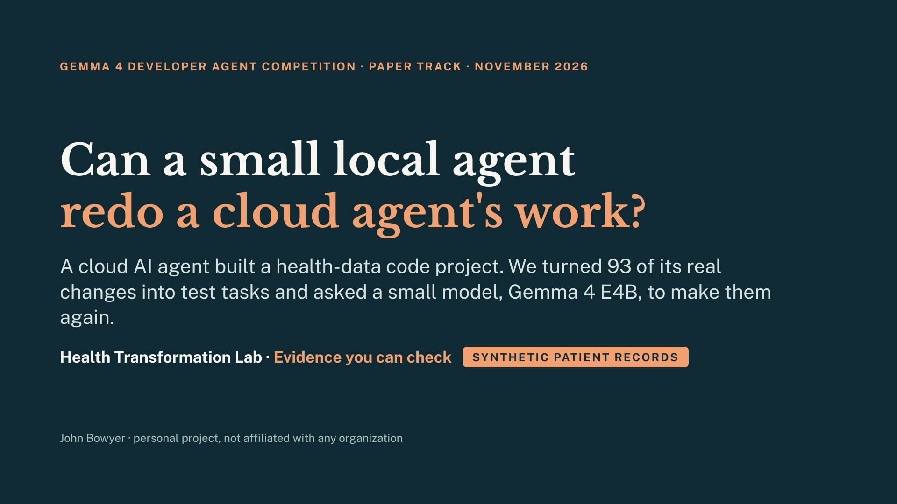

**Speaker notes:** In fifteen days, one person working with a cloud coding agent took a health-data repository from nothing to 960 commits and 2,269 tests, without typing code. This deck asks what a small model, one that runs on a single GPU, can take out of that loop. The answer comes with a task set anyone can use: 93 real changes from that repository, each verified by the competition's own evaluator, which is its scoring program. Every patient record in the repository is synthetic. This is a personal project, not any organization's plan.

The slide's text

Gemma 4 Developer Agent Competition · Paper Track · November 2026  
Can a small local agent  
redo a cloud agent's work?  
A cloud AI agent built a health-data code project. We turned 93 of its real changes into test tasks and asked a small model, Gemma 4 E4B, to make them again.  
Health Transformation Lab ·  
Evidence you can check  
Synthetic patient records  
John Bowyer · personal project, not affiliated with any organization

## Slide 2: Built for people who build and test AI coding agents

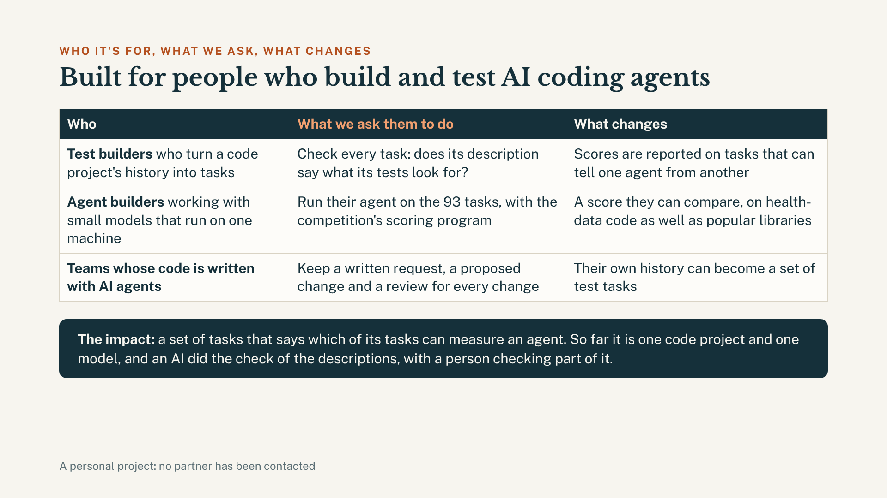

**Speaker notes:** Three kinds of reader. People who build benchmarks from a repository's history: we ask them to check each task's description, which the paper calls its statement, against its tests before reporting a score, because here the fixes were almost all in the tasks that passed that check. People who build agents on small local models: the 93 tasks are public and in the competition's layout, so its evaluator runs on them as published. And teams whose repositories are built with agents: this repository's issues, pull requests and commit messages are where its task descriptions come from. So far this is one repository and one model. A person checked 42 of the screen's 93 verdicts, in summary, and no partner has been contacted.

The slide's text

Who it's for, what we ask, what changes  
Built for people who build and test AI coding agents  
Who  
What we ask them to do  
What changes  
Test builders  
who turn a code project's history into tasks  
Check every task: does its description say what its tests look for?  
Scores are reported on tasks that can tell one agent from another  
Agent builders  
working with small models that run on one machine  
Run their agent on the 93 tasks, with the competition's scoring program  
A score they can compare, on health-data code as well as popular libraries  
Teams whose code is written with AI agents  
Keep a written request, a proposed change and a review for every change  
Their own history can become a set of test tasks  
The impact:  
a set of tasks that says which of its tasks can measure an agent. So far it is one code project and one model, and an AI did the check of the descriptions, with a person checking part of it.  
A personal project: no partner has been contacted

## Slide 3: Tests for AI coding agents use a few popular libraries. Health-data code fails in a different way.

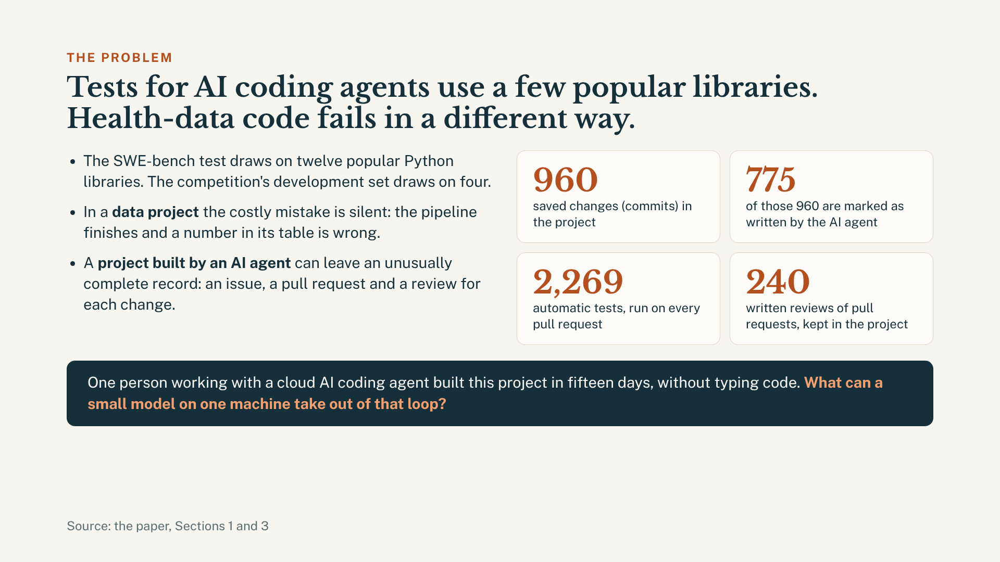

**Speaker notes:** The competition asks whether a model that fits on one accelerator can do the work of the large cloud models behind today's best coding agents. Its tasks, like SWE-bench's, come from a handful of popular libraries. Two kinds of repository are scarce in such sets. In a data repository the costly defect is silent: nothing crashes, and a number in a table is wrong. And a repository built by an agent, under rules that require an issue, a pull request and a review for every change, leaves a record that can be mined. This repository is both. Of its 960 commits, 775 are marked as agent-authored, and it held 2,269 tests on November 8.

The slide's text

The problem  
Tests for AI coding agents use a few popular libraries. Health-data code fails in a different way.  
The SWE-bench test draws on twelve popular Python libraries. The competition's development set draws on four.  
In a  
data project  
the costly mistake is silent: the pipeline finishes and a number in its table is wrong.  
A  
project built by an AI agent  
can leave an unusually complete record: an issue, a pull request and a review for each change.  
960  
saved changes (commits) in the project  
775  
of those 960 are marked as written by the AI agent  
2,269  
automatic tests, run on every pull request  
240  
written reviews of pull requests, kept in the project  
One person working with a cloud AI coding agent built this project in fifteen days, without typing code.  
What can a small model on one machine take out of that loop?  
Source: the paper, Sections 1 and 3

## Slide 4: 197 real code changes became 93 test tasks, each checked by the competition's own scoring program

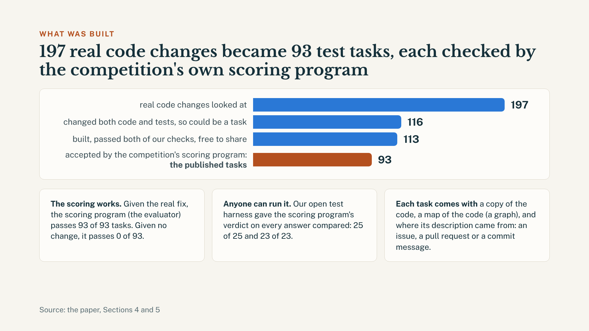

**Speaker notes:** The tasks are made the way the competition makes its own: every merged change whose diff touches both code and tests is a candidate. Of the 197 changes merged by October 29, 2026, 116 are candidates. One was withdrawn, one failed a gate and one was withheld for unlicensed third-party files, leaving 113, and the competition's own evaluator verifies 93 of those: the published set. On them it resolves every reference patch and no empty patch. A local harness, which anyone can run, gives the same verdict as the evaluator on all 48 of the model's patches that were compared. Each task comes with a snapshot of the repository, a code graph, embeddings, and a label saying whether its statement came from an issue, a pull request or a commit message.

The slide's text

What was built  
197 real code changes became 93 test tasks, each checked by the competition's own scoring program  
real code changes merged by October 29, 2026  
197  
changed both code and tests, so could be a task  
116  
built, passed both of our checks, free to share  
113  
accepted by the competition's scoring program:  
the published tasks  
93  
The scoring works.  
Given the real fix, the scoring program (the evaluator) passes 93 of 93 tasks. Given no change, it passes 0 of 93.  
Anyone can run it.  
Our open test harness gave the scoring program's verdict on every answer compared: 25 of 25 and 23 of 23.  
Each task comes with  
a copy of the code, a map of the code (a graph), and where its description came from: an issue, a pull request or a commit message.  
Source: the paper, Sections 4 and 5

## Slide 5: Alone, the model fixed 5 of 48 tasks. In a planned experiment, extra help showed no reliable improvement.

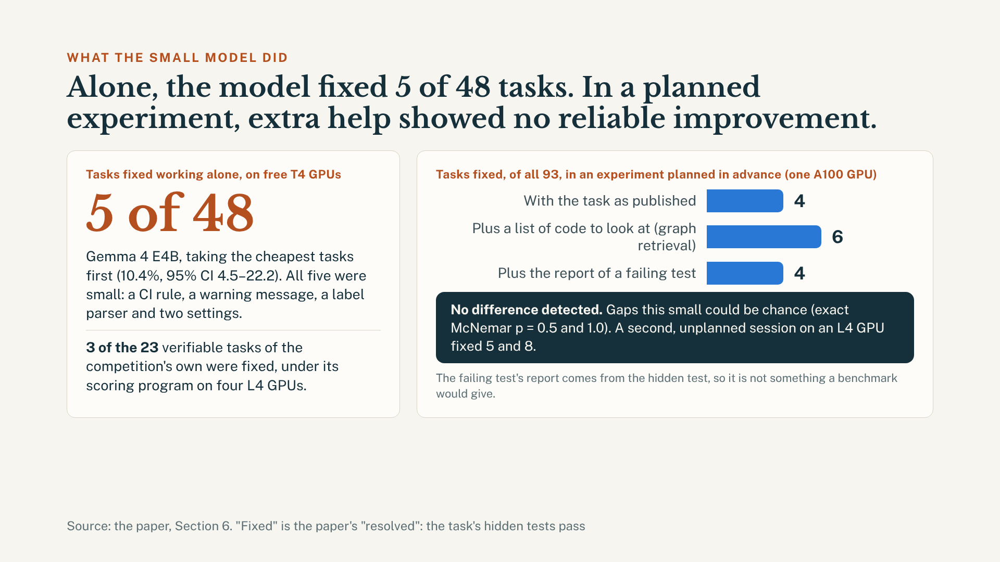

**Speaker notes:** Left on its own on two free T4 GPUs, taking the cheapest tasks first, Gemma 4 E4B resolved 5 of the 48 tasks it ran, all of them small. Under the competition's evaluator, on four L4 GPUs, it resolved 3 of the 23 development tasks of the competition's own that a Kaggle notebook can verify. Then came an experiment registered in advance. Its plan was fixed before any result; Kaggle could not finish it, so all three arms ran again on one A100, under additions to the plan that were fixed before each run started: all 93 tasks, three ways. As published, the model resolved 4. With graph retrieval done for it, which hands it a list of code to look at, 6. With a failing test's report, 4. Neither added context differs detectably from the baseline, and a difference is not ruled out either: at 4 of 93 only a large effect could show. Retrieval's two extra fixes do not establish a reliable improvement. The report uses the hidden test, so it is not a benchmark condition.

The slide's text

What the small model did  
Alone, the model fixed 5 of 48 tasks. In a planned experiment, extra help showed no reliable improvement.  
Tasks fixed working alone, on free T4 GPUs  
5 of 48  
Gemma 4 E4B, taking the cheapest tasks first (10.4%, 95% CI 4.5–22.2). All five were small: a CI rule, a warning message, a label parser and two settings.  
3 of the 23  
verifiable tasks of the competition's own were fixed, under its scoring program on four L4 GPUs.  
Tasks fixed, of all 93, in an experiment planned in advance (one A100 GPU)  
With the task as published  
4  
Plus a list of code to look at (graph retrieval)  
6  
Plus the report of a failing test  
4  
No difference detected.  
Gaps this small could be chance (exact McNemar p = 0.5 and 1.0). A second, unplanned session on an L4 GPU fixed 5 and 8.  
The failing test's report comes from the hidden test, so it is not something a benchmark would give.  
Source: the paper, Section 6. "Fixed" is the paper's "resolved": the task's hidden tests pass

## Slide 6: The model fixed 8 of the 17 clearly described tasks, and only 1 of the other 76

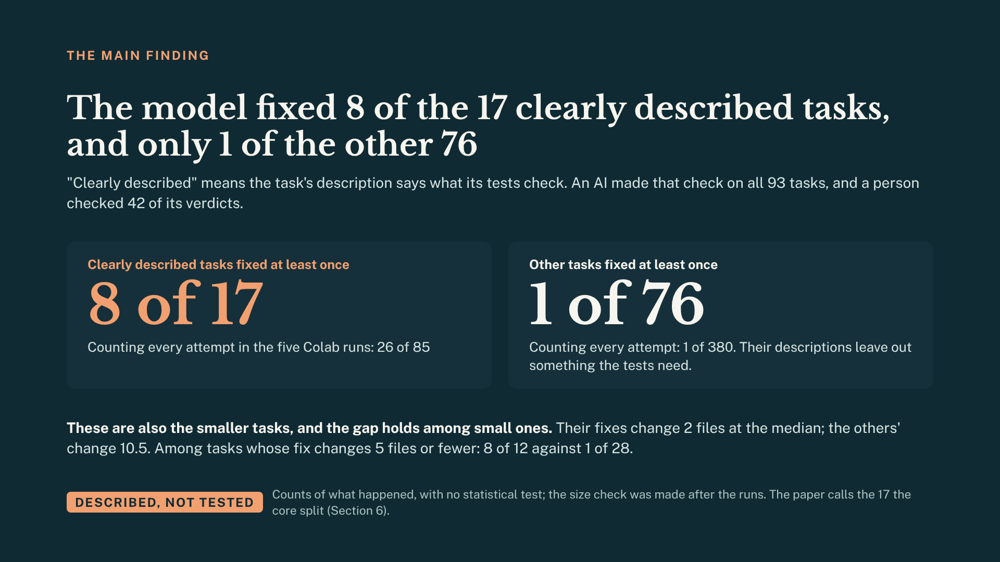

**Speaker notes:** This is the result to take away. An AI screen asked of every task whether its statement, the task's description, says what its tests check. Seventeen of the 93 pass: the paper calls them the core split. The other 76 are real statements that leave out something their tests need, such as a name or a message. Over the five Colab runs, 8 of the 17 core-split tasks were resolved at least once, against 1 of the other 76. Counting every task in every run, that is 26 of 85 against 1 of 380. And finding is not fixing: in the 41 tasks where retrieval listed a function the fix edits, 5 of the core split's 7 were resolved in some run and none of the other 34. So valid tasks whose fix the graph found, but whose statements leave out what their tests need, measured little for this model. These are descriptions, not tests, and the second comparison was made after the runs. A person checked 42 of the screen's verdicts, in summary.

The slide's text

The main finding  
The model fixed 8 of the 17 clearly described tasks, and only 1 of the other 76  
"Clearly described" means the task's description says what its tests check. An AI made that check on all 93 tasks, and a person checked 42 of its verdicts.  
Clearly described tasks fixed at least once  
8 of 17  
Counting every attempt in the five Colab runs: 26 of 85  
Other tasks fixed at least once  
1 of 76  
Counting every attempt: 1 of 380. Their descriptions leave out something the tests need.  
Being pointed at the right code was not enough.  
In 41 tasks the search listed a function the fix changes. Of the 7 clearly described ones, 5 were fixed in some run. Of the other 34, none.  
Described, not tested  
Counts of what happened, with no statistical test; the second comparison was made after the runs. The paper calls the 17 the core split (Section 6).

## Slide 7: A full run of the 93 tasks took about 2 GPU-hours on one A100. One GPU was enough.

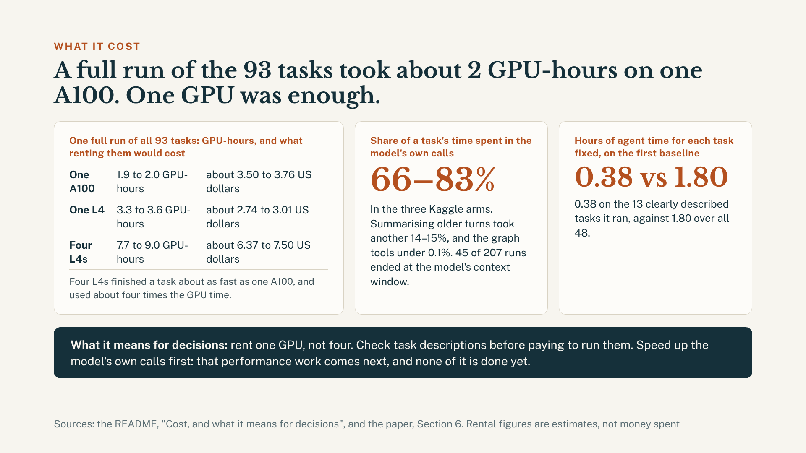

**Speaker notes:** Each run recorded its own GPU time. One full run of the 93 tasks took about 2 GPU-hours on one A100, 3.3 to 3.6 on one L4, and 7.7 to 9.0 on four L4s, which is the competition's own setup. At median rental prices that is an estimated 3.50 to 3.76 US dollars, 2.74 to 3.01, and 6.37 to 7.50. Nothing was paid by the hour: Kaggle's GPUs were free within a weekly allowance, and Colab is a subscription. Four L4s finished a task about as fast as one A100, so for a run of your own one GPU is enough. Each machine ran in its own session, once for each arm, so read these as what happened and not as a benchmark of the machines. From the timing records, 66 to 83 percent of a task's time was the model's own calls, 14 to 15 percent was summarising older turns, and the graph tools took under 0.1 percent. On the first baseline, the 13 clearly described tasks cost 0.38 hours of agent time a fix, against 1.80 over all 48. So three decisions follow: rent one GPU, check task descriptions before paying to run them, and speed up the model's own calls first. That performance work comes next; none of it has been done or measured.

The slide's text

What it cost  
A full run of the 93 tasks took about 2 GPU-hours on one A100. One GPU was enough.  
One full run of all 93 tasks: GPU-hours, and what renting them would cost  
One A100  
1.9 to 2.0 GPU-hours  
about 3.50 to 3.76 US dollars  
One L4  
3.3 to 3.6 GPU-hours  
about 2.74 to 3.01 US dollars  
Four L4s  
7.7 to 9.0 GPU-hours  
about 6.37 to 7.50 US dollars  
Four L4s finished a task about as fast as one A100, and used about four times the GPU time.  
Share of a task's time spent in the model's own calls  
66–83%  
In the three Kaggle arms. Summarising older turns took another 14–15%, and the graph tools under 0.1%. 45 of 207 runs ended at the model's context window.  
Hours of agent time for each task fixed, on the first baseline  
0.38 vs 1.80  
0.38 on the 13 clearly described tasks it ran, against 1.80 over all 48.  
What it means for decisions:  
rent one GPU, not four. Check task descriptions before paying to run them. Speed up the model's own calls first: that performance work comes next, and none of it is done yet.  
Sources: the README, "Cost, and what it means for decisions", and the paper, Section 6. Rental figures are estimates, not money spent

## Slide 8: Use the 93 tasks. Report scores on the 17 clearly described ones.

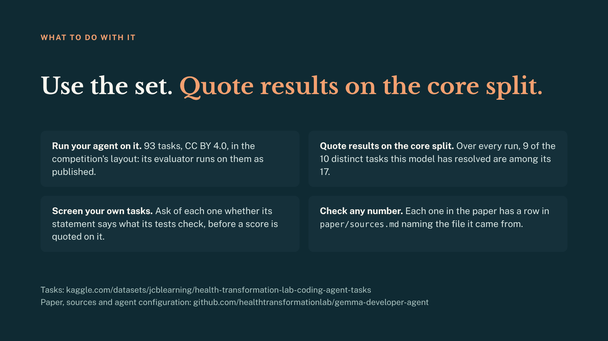

**Speaker notes:** Four things to do with this. Run your agent on the set: 93 tasks under CC BY 4.0, in the competition's layout, so its evaluator runs on them as published, and a quickstart notebook loads a task. Report results on the core split of 17: over every run, 9 of the 10 distinct tasks this model has resolved are in it. Screen your own task set the same way before reporting a score on it. And check any number here: each one in the paper has a row in paper/sources.md that names the file it came from.

The slide's text

What to do with it  
Use the 93 tasks.  
Report scores on the 17 clearly described ones.  
Run your agent on them.  
93 tasks, free to use (CC BY 4.0), in the competition's layout: its scoring program runs on them as published.  
Report scores on the 17.  
Over every run, 9 of the 10 different tasks this model has fixed are among them (the paper's core split).  
Check your own tasks.  
Ask of each one whether its description says what its tests check, before you report a score on it.  
Check any number.  
Each one in the paper has a row in  
paper/sources.md  
naming the file it came from.  
Tasks: kaggle.com/datasets/jcblearning/health-transformation-lab-coding-agent-tasks  
Paper, sources and agent configuration: github.com/healthtransformationlab/gemma-developer-agent

## Slide 9: Drill-down

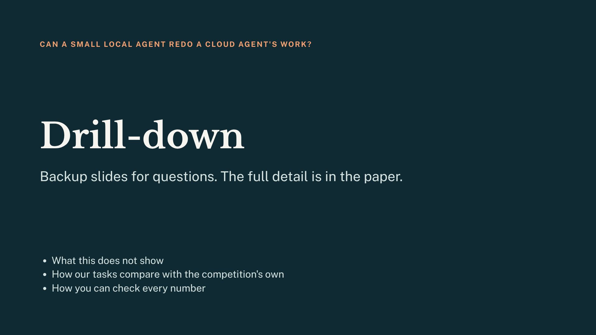

**Speaker notes:** Do not present these. Jump to one only when asked. Everything here is in the paper, and paper/sources.md says where each number comes from.

The slide's text

Can a small local agent redo a cloud agent's work?  
Drill-down  
Backup slides for questions. The full detail is in the paper.  
What this does not show  
How our tasks compare with the competition's own  
How you can check every number

## Slide 10: What this does not show

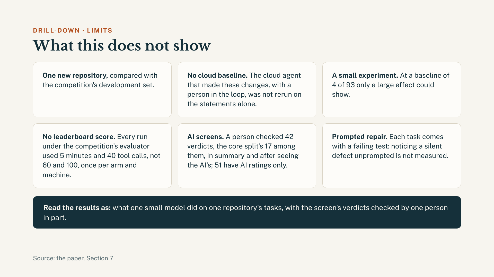

**Speaker notes:** Six limits, all in the paper. One repository, set beside the competition's development set. No cloud baseline: the cloud agent that made these changes with a person in the loop was not rerun on the statements alone, so the title's question is answered for the small model only. A small experiment: at 4 of 93 only a large effect could show. No leaderboard score: the runs used 5 minutes and 40 tool calls where the competition allows 60 and 100. The screens are an AI's: a person checked 42 verdicts in summary, after seeing the AI's, and 51 have AI ratings only. And every task comes with a failing test, so noticing a silent defect unprompted is not measured.

The slide's text

Drill-down · limits  
What this does not show  
Only one new code project,  
set beside the competition's development set.  
No comparison with the cloud agent.  
The agent that made these changes, with a person in the loop, was not rerun on the task descriptions alone.  
A small experiment.  
With 4 of 93 tasks fixed as the starting point, only a large effect could show.  
Not a leaderboard score.  
Every run under the competition's scoring program had 5 minutes and 40 tool calls a task, not the 60 and 100 allowed.  
An AI checked the descriptions.  
A person checked 42 of its verdicts, the 17 clearly described tasks among them, in summary and after seeing the AI's; 51 have AI ratings only.  
The model was told something was wrong.  
Each task comes with a failing test: noticing a silent defect unprompted is not measured.  
Read the results as:  
what one small model did on one project's tasks, with the AI's verdicts checked by one person in part.  
Source: the paper, Section 7

## Slide 11: In 76 of our 93 tasks the tests need something the description never gives. In the competition's: 14 of 40.

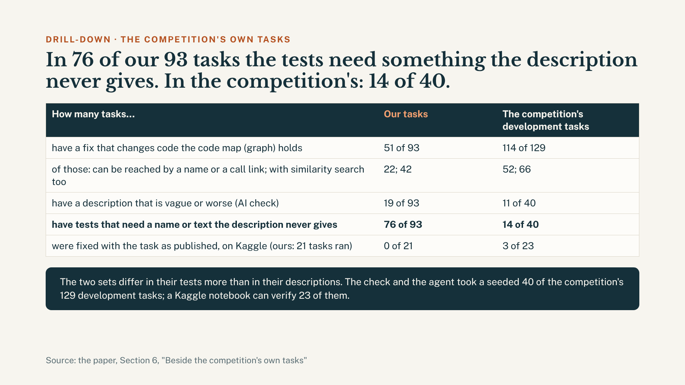

**Speaker notes:** The same counts were made on the competition's own development tasks. Its graph holds more of the fixes: 114 of 129, against 51 of 93 here. Its statements are vague a little more often: 11 of 40, against 19 of 93. The difference is in the tests: in this set the tests of 76 of 93 tasks need a name or a text the statement never gives, against 14 of 40 there. The screen and the agent took a seeded 40 of the 129, stratified by repository. In a Kaggle notebook the evaluator's sandbox has no pip to install test dependencies: there the reference patch fails 16 of the 40 and one passes with an empty patch, leaving 23, and the model resolved 3 of them. On this set the Kaggle baseline ran 21 tasks before its model server stopped answering, and resolved none.

The slide's text

Drill-down · the competition's own tasks  
In 76 of our 93 tasks the tests need something the description never gives. In the competition's: 14 of 40.  
How many tasks…  
Our tasks  
The competition's development tasks  
have a fix that changes code the code map (graph) holds  
51 of 93  
114 of 129  
of those: can be reached by a name or a call link; with similarity search too  
22; 42  
52; 66  
have a description that is vague or worse (AI check)  
19 of 93  
11 of 40  
have tests that need a name or text the description never gives  
76 of 93  
14 of 40  
were fixed with the task as published, on Kaggle (ours: 21 tasks ran)  
0 of 21  
3 of 23  
The two sets differ in their tests more than in their descriptions. The check and the agent took a seeded 40 of the competition's 129 development tasks; a Kaggle notebook can verify 23 of them.  
Source: the paper, Section 6, "Beside the competition's own tasks"

## Slide 12: How you can check every number

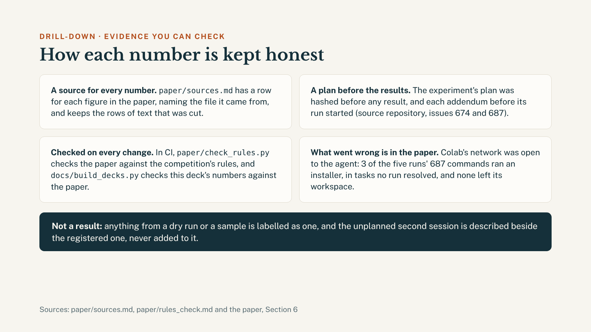

**Speaker notes:** Four habits keep the numbers honest. Every figure in the paper has a row in paper/sources.md naming the file it came from, and rows stay when text is cut. The experiment's plan was hashed before any result, and each addendum before its run. A script checks the paper against the competition's rules on every change, and another checks that every number in this deck appears in the paper or the README. And what went wrong is in the paper: on Colab the network was open to the agent's commands, 3 of 687 commands ran an installer, in tasks no run resolved, and none left its workspace. The unplanned second session on an L4 is described beside the registered experiment and kept out of its tests; where a count covers both sessions, as on the main finding's slide, it says five runs.

The slide's text

Drill-down · evidence you can check  
How you can check every number  
A source for every number.  
paper/sources.md  
has a row for each figure in the paper, naming the file it came from, and keeps the rows of text that was cut.  
A plan before the results.  
The experiment's plan was fixed and fingerprinted (hashed) before any result, and each addition to it before its run started (source repository, issues 674 and 687).  
Checked on every change.  
One script checks the paper against the competition's rules, and another checks that every number in this deck appears in the paper or the README.  
What went wrong is in the paper.  
On Colab the network was open to the agent: 3 of the five runs' 687 commands ran an installer, in tasks no run fixed, and none left its workspace.  
Not a result:  
anything from a dry run or a sample is labelled as one, and the unplanned second session is described beside the planned experiment and kept out of its tests. A count that covers both says five runs.  
Sources: paper/sources.md, paper/rules_check.md and the paper, Section 6

