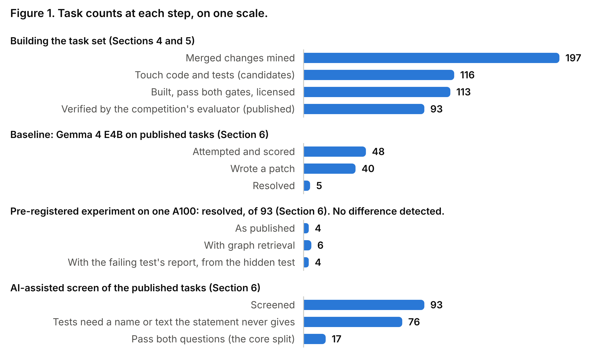

# Can a small local agent redo a cloud agent's work?

**93 evaluator-verified tasks from an agent-built health-data repository, with an open harness and a Gemma 4 E4B baseline**

**John Bowyer**, Health Transformation Lab

Gemma 4 Developer Agent Competition, Paper Track [14]. Topic: Tasks & Benchmarks (resource paper). November 2026.

*A personal learning project, not affiliated with or endorsed by any employer, institution or vendor. Every patient record in the source repository is synthetic.*

## Abstract

In fifteen days, one person in the loop with a cloud coding agent took a health-data repository from nothing to 960 commits and 2,269 tests, without typing code. Scripts turn its CI-enforced record into 93 health-data modelling tasks by the competition's mining rule, format and evaluator; an AI screen finds 17 whose statements say what their tests check, the core split. What can a small local model take out of that loop? **What it did unattended:** on free T4 GPUs, Gemma 4 E4B resolved 5 of the 48 tasks it ran, cheapest first; under the competition's evaluator, 3 of 23 verifiable tasks of its own. **With more context,** pre-registered, under that evaluator on one A100: as published, 4 of 93; with graph retrieval done for it, 6; with a failing test's report (from the hidden test: not a benchmark condition), 4. Neither differs detectably from the baseline (exact McNemar p = 0.5, 1.0); an unplanned second session on an L4 resolved 5 and 8. **Where those fixes were:** 26 of 27 in the core split. **What the graph could tell it:** it holds the edited code in 51 of the 93 tasks (114 of 129 in the competition's) and leads from statement to fix in 42 of the 51. **Where its time went:** 66–83% of a task was model calls (OpenTelemetry spans).

**Data and code.** Tasks (CC BY 4.0): [kaggle.com/datasets/jcblearning/health-transformation-lab-coding-agent-tasks](https://www.kaggle.com/datasets/jcblearning/health-transformation-lab-coding-agent-tasks). Quickstart notebook: [kaggle.com/code/jcblearning/coding-agent-tasks-quickstart](https://www.kaggle.com/code/jcblearning/coding-agent-tasks-quickstart). Harness, builders and run tables (Apache 2.0): [github.com/healthtransformationlab/health-transformation-lab-nlp](https://github.com/healthtransformationlab/health-transformation-lab-nlp). Agent configuration and each number's source (Apache 2.0): [github.com/healthtransformationlab/gemma-developer-agent](https://github.com/healthtransformationlab/gemma-developer-agent).

## 1. Introduction

This competition [14] asks whether a model that fits on one accelerator can do the work of the large cloud models behind today's best coding agents. SWE-bench draws on twelve popular Python libraries [1], and the competition's development set on four.

Two kinds of repository are scarce. In a **data repository** the costly defect is silent: a pipeline finishes and a number in its table is wrong. An **agent-built repository** can leave an unusually complete record: an issue, a pull request and a review for each change.

This paper adds one repository that is both, set beside the competition's four by its mining rule, format and evaluator. `health-transformation-lab-nlp` exists to surface silent defects, here in how well gum disease can be found in synthetic dental records, so its tasks are real changes to application code: de-identification, record checks, model scoring, pipelines.

Contributions:

1. **A task set**: 93 health-data modelling tasks in the competition's format, each verified by its evaluator and labelled with its statement's source, with a 17-task core split (Sections 4 and 6).
2. **An open harness** that agrees with the competition's evaluator on every saved agent patch and keeps answers from the model (Section 5).
3. **A baseline and a pre-registered experiment** for Gemma 4 E4B: a local harness, the competition's evaluator on this set and its own, and all 93 tasks on one GPU as published, with graph retrieval and with a failing test's report (Section 6).
4. **Checks on the recipe**: whether statements say what their tests check, and where the graph leads from statement to fix, both also on the competition's tasks (Sections 4.3 and 6).

## 2. Related work

**Task sets from repository history.** SWE-bench pairs GitHub issues with the pull requests that closed them and scores a patch by the repository's tests [1]; SWE-bench Verified adds human screening of task quality [2]. SWE-Gym [5], SWE-smith [6] and SWE-rebench [7] scale collection for training and fresh evaluation.

**Agents and graphs.** SWE-agent showed that the interface matters as much as the model [8]. RepoGraph [3] and LocAgent [4] lead an agent to the code to edit by finding an issue's terms in a code graph and walking its edges; Section 4.3 counts how often such a walk exists, and Section 6 runs the agent with the walk done for it. In this track, one entry counts such signals on the competition's 129 tasks [15].

**Data work.** DS-1000 tests data-science code generation [9]; Spider 2.0 [10], ELT-Bench [11] and data-eng-bench [13] score a produced artefact. MLOps-Bench [12] is closest: 212 fail-to-pass tasks from 31 public ML repositories.

## 3. The source repository

The repository holds a Python package and tests, an R twin, SQL and Databricks pipelines, and documentation, written October 25 to November 8, 2026.

**Who wrote it.** Of 960 commits on `main`, 775 are marked as agent-authored; the rest are merge commits (175), a bot's (5), the author's (4) and the initial one.

**Rules the agents work under.** A checked-in `AGENTS.md` requires an issue per user story, a pull request tied to it and a test before the code; CI rejects a pull request without an issue link. Each pull request has a committed review (240). On November 8 it held 2,269 tests in 126 files, run by CI on every pull request.

## 4. Building the task set

### 4.1 Mining

The mining script reads every merged pull request and every first-parent commit on `main` as of October 29, 2026: 197 changes. A change is a **candidate** when its diff touches both non-test code and test files: the competition's own mining rule.

Of those, 116 are candidates. One was withdrawn, one failed a gate and one was withheld for unlicensed third-party files, leaving 113; the competition's evaluator verifies 93 of them (Section 5), the published set.

### 4.2 Fidelity tiers

Each task records where its `problem_statement` came from.

| Tier | Statement source | Candidates (published) |
|---|---|---|
| A | the issue body | 49 (39) |
| B | the pull request's title and body (no issue existed) | 45 (34) |
| C | the commit message (no pull request existed) | 22 (20) |

### 4.3 Snapshots, graphs, embeddings

A snapshot is the tree at `base_commit` as a single commit. The code graph is an AST walk over the package into NetworkX node-link JSON with the competition's keys: a node for each function, class and method with its source text, and a `calls` edge where one calls another. Embeddings come from EmbeddingGemma, cut to 256 dimensions; a format check against the competition's own files matched.

The graph misses the fix in 42 of the 93 tasks: 31 touch no module it covers and 11 change no existing function or class. In the other 51, the statement names an edited function or class in 20, call edges lead there from one it names in 2 more, and in 29 neither does. Embedding search does more: ranking a graph's nodes (median 398) by similarity to the statement puts an edited one first in 15 of the 51 (0.6 expected by chance) and in the first ten in 30 (5.4 by chance), 20 of them among those 29. So by name, call edge or embedding search the graph leads to the fix in 42 of the 51.

An oracle-assisted analysis adds a failing test's report. Run at the base commit, the tests of 23 of the 51 tasks call an edited function, but only 1 in a task those three miss. In 15 the tests fail at import, and 13 of those errors name a module the fix changes, 5 in tasks those three miss: with the report, 48 of the 51. This analysis uses the hidden test and the reference fix, so it is not a result an agent achieved; Section 6 gives an agent the report.

### 4.4 Gates

A task is kept only if its tests fail at `base_commit` with the test patch alone, and pass once the reference patch is applied with the files the grader strips removed. All 115 fail without the fix; 114 pass with it.

## 5. Harness and verification

**The local harness.** It re-implements the one the competition's guide documents. Replaying each reference patch from the repository's history resolves 111 of 113 tasks; submitting nothing, none.

**The competition's evaluator.** Its own verification (`swegemma` 0.2.11, subprocess sandbox, unmodified) then ran on the 113 tasks first published and on the corrected release.

| Snapshots | Reference patch resolves | Empty patch | Both verifiers on Gemma's patches |
|---|---|---|---|
| First release, with the import fix below | 93 of 113 | 0 of 113 | agree on 25 of 25 |
| Corrected release, as published | 93 of 93 | 0 of 93 | agree on 23 of 23 |

As first published, no task could be scored: the evaluator imports from the repository root, and this package sits in `python/`. The corrected release adds a short root `conftest.py` and keeps only the 93.

Of the 20 left out, twelve read withheld third-party files, six run a script that the evaluator's `PYTHONSAFEPATH=1` forbids, and two need Postgres or R.

**Keeping answers from the model.** Later snapshots hold earlier tasks' fixes, so each task runs alone: locally in Linux namespaces with no network, on Kaggle in a private offline notebook with the others absent or sealed.

**Known differences.** Namespaces, not a container; no context compaction, prefix caching, sub-agents or skills; `PYTHONSAFEPATH` unset. No number here is a competition score.

## 6. Baseline

**Setup.** `gemma-4-e4b-it` in fp16 with transformers on two T4 GPUs, internet off, thinking off, at most 2,048 new tokens per turn, a 24,576-token context, 40 tool calls, 60 turns and 30 minutes per task. Tasks ran cheapest first under a GPU-hour cap, so no rate here estimates the 93.

**Results.** Ten of the 58 tasks attempted were excluded from the set. On the other 48 the model wrote a patch for 40 and resolved 5 (10.4%, 95% Wilson CI 4.5–22.2), all small: a CI rule, a warning message, a label parser and two settings.

**A larger budget.** Rerun on one Colab L4 with eight times the output tokens, thinking on and 100 tool calls, the 23 cheapest of the 48 resolved 2, against 2 under the tight limits.

**Task fairness.** Two AI screens rated tasks on SWE-bench Verified's two questions [2]. The first took a random 30; the author checked its findings in summary and agreed with all 30. An independent second pass, blind to the first, rated all 93: the same verdict on all 30, and 17 of 93 pass. Those 17 are the set's **core split**; the author later checked its 12 verdicts outside the 30, in summary, and agreed with all. The other 76 stay, as real statements that leave out what their tests need.

**A pre-registered experiment under the competition's evaluator.** The agent was then run with the official harness: `swegemma`'s agent loop, vLLM from the competition's wheelhouse, four L4 GPUs and its competition settings (16,384 output tokens, a 4,096-token thinking budget, 40 tool calls, 5 minutes), each task alone, without patch or tests. A first seeded sample of 20 resolved none. Then all 93 were to run three times, under a plan hashed before any result (source repository, issue 674): as published; with **graph retrieval** done for the agent (named nodes, their call neighbours and the ten nearest by embedding search, from statement and graph alone); and with the **failing test's report** (its errors and the public functions it called), which uses the hidden test: a test-first workflow's context, not a benchmark condition.

| Tasks resolved | Kaggle, four L4s | Colab, one A100: of 93 (95% CI) |
|---|---|---|
| As published | 0 of 21 run | 4 (1.7–10.5%) |
| With graph retrieval | 4 of 93 | 6 (3–13.4%) |
| With the failing test's report | 5 of 93 | 4 (1.7–10.5%) |

On Kaggle the baseline's model server stopped answering after 21 tasks, none of which any arm resolved, and Kaggle refused the plan's one rerun (GPU allowance spent). So all three arms ran again on one Colab A100, under addenda hashed before each started (issue 687), with Python 3.13 and nine packages at other versions. Graph retrieval resolved the baseline's 4 tasks and 2 more (exact McNemar p = 0.5), the report 3 of them and 1 more (p = 1.0): no difference is claimed or ruled out. An unplanned second session ran the first two arms on an L4: 5 and 8 (p = 0.375, described only); the two baselines differed on 3 tasks. Described, not tested: the core split's 17 tasks were resolved in 26 of 85 Colab task-runs, the other 76 in 1 of 380. Finding is not fixing: where retrieval listed an edited function (41 tasks, of Section 4.3's 51), the graph arm resolved 3 and the baseline 2. Colab's network was open to the agent: 3 of the five runs' 687 commands ran an installer, in tasks no run resolved, and none left its workspace.

**Beside the competition's own tasks.** The graph counts were repeated on its 129 development tasks; the screen and the agent took a seeded 40, stratified by repository. In a Kaggle notebook the evaluator's sandbox has no pip to install test dependencies: there the reference patch fails 16 of the 40 and one passes with an empty patch, leaving 23. The agent's notebook mounts the competition's reference patches; no tool call named a path outside its workspace.

| | This set | Development set |
|---|---|---|
| The fix edits a function the graph holds | 51 of 93 | 114 of 129 |
| Of those: a name or call edge reaches it; with embedding search too | 22; 42 | 52; 66 |
| Statement vague or worse (AI screen) | 19 of 93 | 11 of 40 |
| Tests need a name or text the statement never gives | 76 of 93 | 14 of 40 |
| Resolved as published, on Kaggle | 0 of 21 | 3 of 23 |
| Tool calls to a graph tool, as published (all runs) | 17 of 207 | 83 of 439 |

**Time, GPUs and cost.** The Kaggle arms' OpenTelemetry spans put 66–83% of a task's time in model calls, 14–15% in context compaction and under 0.1% in the graph tools; 45 of 207 runs ended at the model's context window. A task took 297–419 GPU-seconds on the four L4s and 4.8–6.7 Wh, and a fix 1.9 GPU-hours with graph retrieval and 1.8 with the report, about 1.59 and 1.50 US dollars at a median rental of 0.83 an L4-hour (Kaggle's were free). On the T4 baseline, the 13 core-split tasks it ran took 17% of its 9.0 agent-hours and gave 4 of its 5 fixes: 0.38 a fix against 1.80 overall.

## 7. Limitations

- **One new repository**, compared with the competition's development set.
- **No cloud baseline.** The cloud agent that made these changes, with a person in the loop, was not rerun on the statements alone.
- **A small experiment.** At a baseline of 4 of 93 only a large effect could show. The Kaggle rerun is owed (source repository, issue 681).
- **No leaderboard score.** Every run under the competition's evaluator used 5 minutes and 40 tool calls, not 60 and 100, once per arm and machine at temperature 0.2.
- **AI screens.** A person checked 42 verdicts, the core split's 17 among them, in summary and after seeing the AI's; 51 of ours and all 40 development tasks have AI ratings only.
- **Prompted repair.** Each task comes with a failing test: noticing a silent defect unprompted is not measured.

## 8. Conclusion and release

A model that runs on free GPUs resolved 5 of 48 cheapest-first tasks, and 3 of 23 of the competition's own under its evaluator. On one A100, in an experiment registered before it ran, it resolved 4 of all 93 as published, 6 with graph retrieval done for it and 4 with a failing test's report (from the hidden test): no difference detected, there or in an unplanned second session on an L4 (5 and 8). Over every run, 9 of the 10 tasks this model has resolved are in the core split of 17, which is where a result on this set should be quoted. On the competition's tasks the graph holds more fixes and the screen passes half: the two sets differ in their tests more than their statements.

**Using the set.** The dataset has the competition's layout, so its evaluator runs on it as published. In the repository, `kaggle/official_verify.py` replays the two controls; the quickstart notebook loads a task.

## References

1. Jimenez et al. SWE-bench: Can Language Models Resolve Real-World GitHub Issues? ICLR 2024.
2. Chowdhury et al. Introducing SWE-bench Verified. OpenAI, 2024.
3. Ouyang et al. RepoGraph: Enhancing AI Software Engineering with Repository-level Code Graph. ICLR 2025.
4. Chen et al. LocAgent: Graph-Guided LLM Agents for Code Localization. ACL 2025.
5. Pan et al. Training Software Engineering Agents and Verifiers with SWE-Gym. ICML 2025.
6. Yang et al. SWE-smith: Scaling Data for Software Engineering Agents. NeurIPS 2025.
7. Badertdinov et al. SWE-rebench: An Automated Pipeline for Task Collection and Decontaminated Evaluation of Software Engineering Agents. NeurIPS 2025.
8. Yang et al. SWE-agent: Agent-Computer Interfaces Enable Automated Software Engineering. NeurIPS 2024.
9. Lai et al. DS-1000: A Natural and Reliable Benchmark for Data Science Code Generation. ICML 2023.
10. Lei et al. Spider 2.0: Evaluating Language Models on Real-World Enterprise Text-to-SQL Workflows. ICLR 2025.
11. Jin, Zhu, Kang. ELT-Bench: An End-to-End Benchmark for Evaluating AI Agents on ELT Pipelines. PVLDB, 2026.
12. Tran et al. MLOps-Bench: Benchmarking AI Agents on Production ML Engineering in Real Repositories. arXiv:2610.23506, 2026.
13. Snowflake Inc. data-eng-bench: a data-engineering benchmark for coding agents. github.com/Snowflake-Labs/data-eng-bench, 2026.
14. Markowitz et al. Google - The Gemma 4 Developer Agent Competition. Kaggle, 2026. https://www.kaggle.com/competitions/gemma-4-developer-agent
15. Hassan. Model-free localization benchmark on the 129 public tasks. Kaggle discussion, 2026.
